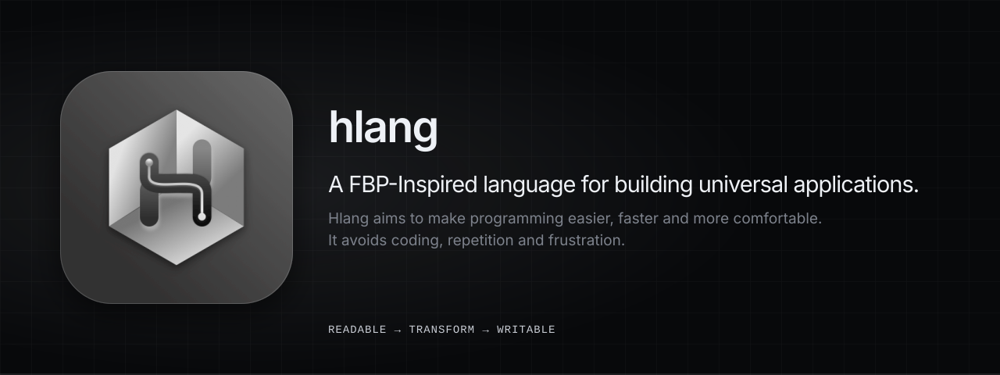
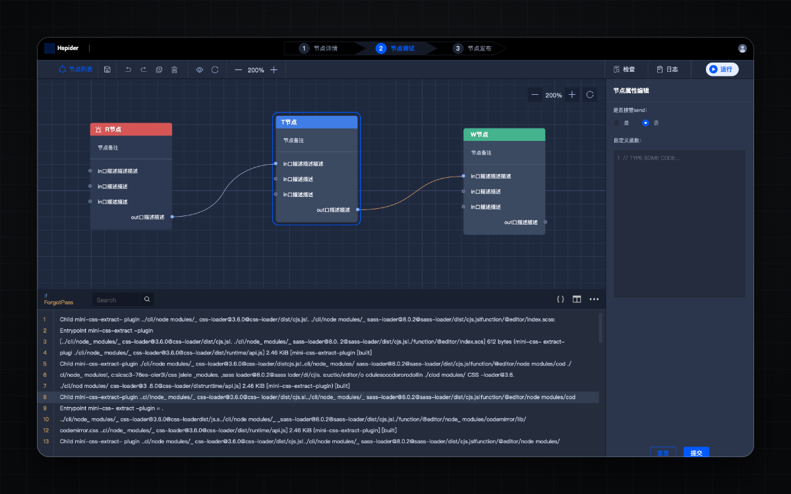
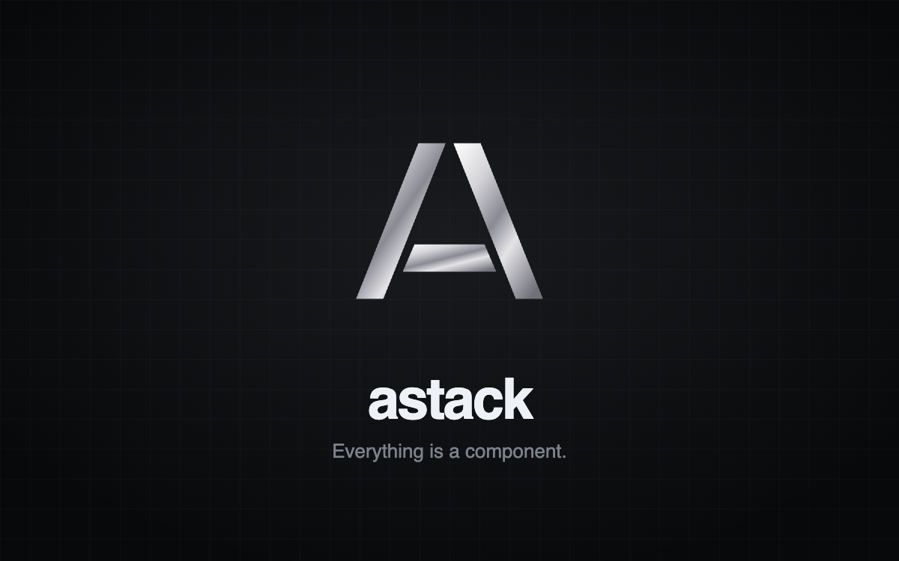
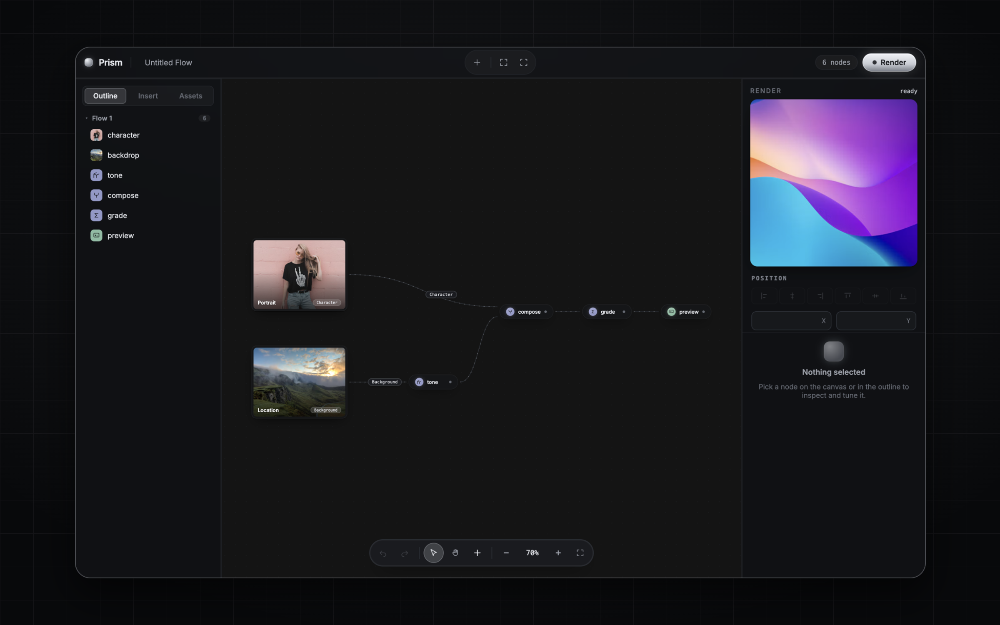
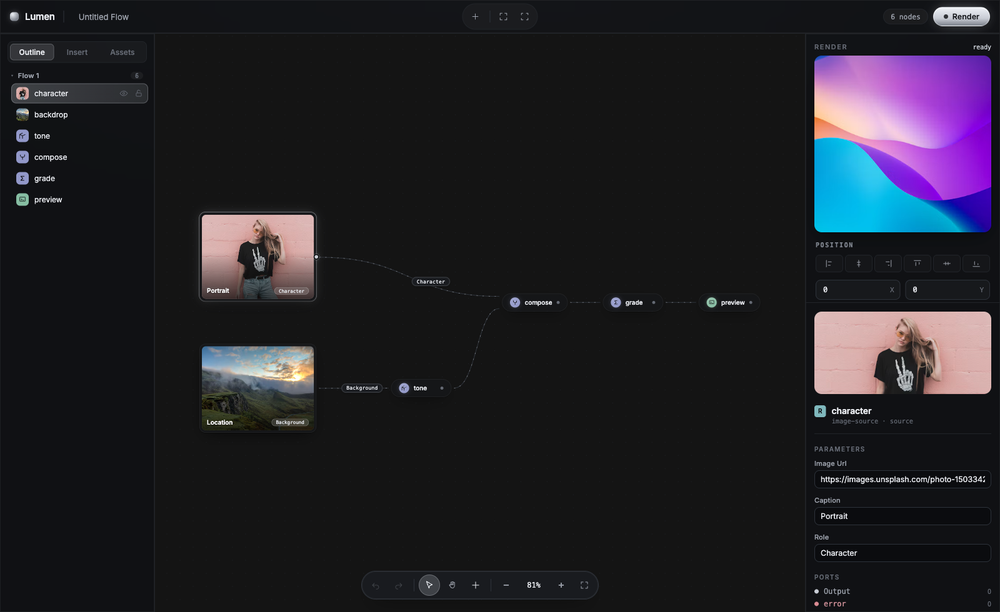
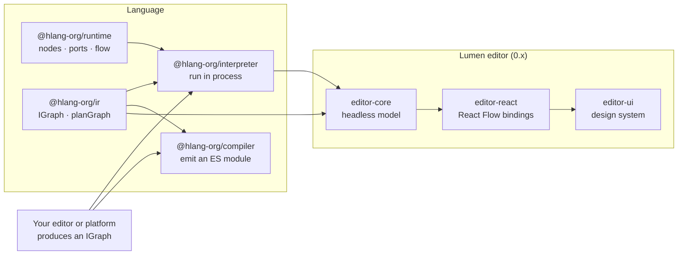

<p align="center">
  
</p>

<p align="center">
  <b>A FBP-Inspired language for building universal applications.</b>
  <br />
  <em>Hlang aims to make programming easier, faster and more comfortable. It avoids coding, repetition and frustration.</em>
</p>

<p align="center">
  <a href="https://github.com/hlang-tech/hlang/actions/workflows/ci.yml"></a>
  <a href="https://www.npmjs.com/package/@hlang-org/runtime"></a>
  <a href="./LICENSE"></a>
  <a href="https://deepwiki.com/hlang-tech/hlang"></a>
</p>

<p align="center">
  <b>English</b> · <a href="./README.zh-CN.md">简体中文</a>
</p>

hlang is a flow-based programming language for TypeScript and JavaScript. A program is a graph of nodes. Nodes exchange data through named ports, and every port is an RxJS stream. Connections stay live: data moves through the graph as long as the sources keep emitting.

You can write a graph in code with the runtime, store it as a JSON program (`IGraph`), run that program with the interpreter, or compile it to an ES module. hlang does not depend on any editor: a visual tool only has to produce an `IGraph`. Teams have built their own editors and platforms on hlang, and this repository develops Lumen, an editor stack for creative tools.

## Contents

- [Core concepts](#core-concepts)
- [Packages](#packages)
- [Quick start](#quick-start)
- [Built on hlang](#built-on-hlang)
- [Architecture](#architecture)
- [Development](#development)
- [Brand](#brand)
- [Contributors](#contributors)

## Core concepts

| Concept | In hlang |
| --- | --- |
| **Node** | A unit of computation. There are three kinds. |
| **Readable (R)** | A source. It has output ports only. `_read($o)` pushes data. |
| **Transform (T)** | It has input and output ports. `_transform($i, $o)` maps inputs to outputs. |
| **Writable (W)** | A sink. It has input ports only. `_write($i)` consumes data. |
| **Port** | A named RxJS `Subject`. `send()` calls `next()`; `receive()` subscribes. A node can have any number of ports. |
| **Error port** | Readable and Transform nodes have an output port named `@node/error` for errors. |
| **Connection** | `output.connect(input)`. The runtime throws for any other direction. Transform-to-Transform cycles are allowed, so feedback loops are possible. |
| **Flow** | `flow.run(readable)` builds the graph that is reachable from a Readable root. It subscribes the downstream nodes first, then lets the source emit. |
| **IGraph** | The JSON form of a program: `nodeList` and `connections`. It is the input of the interpreter, the compiler, and the editor. |

## Packages

All packages are published under the `@hlang-org` scope. Identical builds are also published under `@hlang-tech`. Use one scope in a project.

| Package | Version | Purpose |
| --- | --- | --- |
| [`@hlang-org/runtime`](./packages/runtime) |  | Nodes, ports, and flows on RxJS. The engine every other package builds on. |
| [`@hlang-org/ir`](./packages/ir) |  | `IGraph` types and `planGraph`, the validation and lowering step shared by the interpreter and the compiler. |
| [`@hlang-org/interpreter`](./packages/interpreter) |  | Runs an `IGraph` in the current process. No code generation. Works in Node.js and browsers. |
| [`@hlang-org/compiler`](./packages/compiler) |  | Compiles an `IGraph` to a standalone ES module with the same behavior as the interpreter. |
| [`@hlang-org/editor-core`](./packages/editor-core) |  | Lumen: the headless editor model. Commands, undo and redo, validation, diagnostics, `IGraph` serialization. |
| [`@hlang-org/editor-react`](./packages/editor-react) |  | Lumen: React hooks that bind `editor-core` to React Flow. |
| [`@hlang-org/editor-ui`](./packages/editor-ui) |  | Lumen: the design system. Nodes, edges, panels, and the editor shell. |

The Lumen packages (`editor-*`, version 0.x) are in active development. Their APIs can change in any minor release.

## Quick start

### Write a graph in code

```sh
npm install @hlang-org/runtime
```

```js
const { Flow, ReadableNode, TransformNode, WriteableNode, Port } = require('@hlang-org/runtime');

class Greeting extends ReadableNode {
  constructor(opts) {
    super(opts);
    Port.O('out').attach(this);
  }
  _read($o) {
    $o('out').send('hello, hlang');
  }
}

class Uppercase extends TransformNode {
  constructor(opts) {
    super(opts);
    Port.I('in').attach(this);
    Port.O('out').attach(this);
  }
  _transform($i, $o) {
    $i('in').receive((text) => $o('out').send(text.toUpperCase()));
  }
}

class Print extends WriteableNode {
  constructor(opts) {
    super(opts);
    Port.I('in').attach(this);
  }
  _write($i) {
    $i('in').receive((text) => console.log(text));
  }
}

const greeting = new Greeting();
const uppercase = new Uppercase();
const print = new Print();

greeting.O('out').connect(uppercase.I('in'));
uppercase.O('out').connect(print.I('in'));

new Flow().run(greeting); // HELLO, HLANG
```

### Run the same graph as data

An `IGraph` describes the same program as JSON. A connection's `Output` is the upstream port and its `Input` is the downstream port.

```js
const { Flow } = require('@hlang-org/runtime');
const { interpret, NodeRegistry } = require('@hlang-org/interpreter');

const registry = new NodeRegistry()
  .register('greeting', Greeting)
  .register('uppercase', Uppercase)
  .register('print', Print);

const graph = {
  nodeList: [
    { nodeId: 'a', code: 'greeting', name: 'Greeting', type: 'R' },
    { nodeId: 'b', code: 'uppercase', name: 'Uppercase', type: 'T' },
    { nodeId: 'c', code: 'print', name: 'Print', type: 'W' },
  ],
  connections: [
    { Output: { nodeId: 'a', portConf: { id: 'out' } }, Input: { nodeId: 'b', portConf: { id: 'in' } } },
    { Output: { nodeId: 'b', portConf: { id: 'out' } }, Input: { nodeId: 'c', portConf: { id: 'in' } } },
  ],
};

const handle = interpret(graph, { registry, createFlow: () => new Flow() });
handle.onError(({ nodeId, error }) => console.error(nodeId, error));
handle.dispose(); // stops long-running nodes
```

### Compile it to a module

```js
import { compile } from '@hlang-org/compiler';

const { code, imports } = compile(graph, {
  nodes: {
    greeting: { from: './nodes/greeting.js' },
    uppercase: { from: './nodes/uppercase.js' },
    print: { from: './nodes/print.js' },
  },
});
// `code` is an ES module that exports run(options). `imports` lists the modules it needs.
```

## Built on hlang

The language, the execution backends, and the editors are separate layers. Anything that produces an `IGraph` can run it with the interpreter or ship it with the compiler, so each product builds its own surface on the same engine.

<table>
  <tr>
    <td width="33%" valign="top">
      <a href="https://www.xiaoa.name/events/hlang-chinashop-2020/"></a>
      <p><b>Retail store operations</b><br><sub>Freshippo Rex · CHINASHOP 2020</sub></p>
      <p>The logic orchestration engine of Rex's store operations solution. Store logic was built, demonstrated, and debugged as flows.</p>
    </td>
    <td width="33%" valign="top">
      <a href="https://github.com/astack-tech/astack"></a>
      <p><b>AStack</b><br><sub>AI agents and workflows</sub></p>
      <p>A composable TypeScript framework for AI applications. Components, ports, and pipelines on hlang's computational model.</p>
    </td>
    <td width="33%" valign="top">
      <a href="./examples/editor-react-playground"></a>
      <p><b>Prism</b><br><sub>Image and video creation · in development</sub></p>
      <p>A node-based tool for creators, built on Lumen. Its image sources, intent nodes, and render preview are hlang nodes, and what it builds is an IGraph.</p>
    </td>
  </tr>
</table>

### Lumen

Lumen edits an `IGraph` and runs it with the interpreter. It is generic: it knows nodes, ports, and graphs, and nothing about any one product. Its three layers depend in one direction only, and each can be replaced.

<p align="center">
  
</p>

| | `editor-core` | `editor-react` | `editor-ui` |
| --- | --- | --- | --- |
| **Layer** | Model | Binding | Design |
| **Depends on** | `ir`, `interpreter` | `editor-core`, React Flow | `editor-react` |
| **Owns** | Commands with undo and redo, connection validation, edit-time diagnostics, `IGraph` serialization. No React, no DOM. | Hooks that bind the core to [React Flow](https://reactflow.dev). Output ports map to sources, input ports to targets. | Image and intent nodes, live edges, outline, inspector, node search, context menu, shortcuts. |

A different design system can sit on `editor-react`, and a different framework binding on `editor-core`. Try the [playground](./examples/editor-react-playground):

```sh
pnpm install
pnpm dev:playground
```

## Architecture



The interpreter and the compiler share one front end. `planGraph` validates an `IGraph` and lowers it to an execution plan. The interpreter executes the plan in the current process. The compiler prints the same plan as an ES module. A test runs one graph through both backends and compares the results.

## Development

The repository is a [pnpm](https://pnpm.io) workspace with [Turborepo](https://turborepo.com) tasks and [Changesets](https://github.com/changesets/changesets) for releases. Use the Node.js version in [`.nvmrc`](./.nvmrc).

```sh
pnpm install        # install and link the workspace
pnpm build          # build every package
pnpm check          # build, typecheck, lint, and test; the CI gate
pnpm lint:pkg       # validate the publishable packages (publint + attw)
```

`main` holds released code and `develop` holds the next release. Start work on a `feature/*` branch from `develop`. See [CONTRIBUTING.md](./.github/CONTRIBUTING.md) for the workflow, the quality bar, and the release process. Engineering rules for people and coding agents are in [AGENTS.md](./AGENTS.md).

## Brand

The hlang mark is a node with one connection: a cube, an output terminal, a trace that forms the H, and an input terminal. See the [brand guide](./media/brand/README.md) for the construction, colors, and files.

## Contributors

<!-- ALL-CONTRIBUTORS-LIST:START - Do not remove or modify this section -->
<!-- prettier-ignore-start -->
<!-- markdownlint-disable -->
<table>
  <tbody>
    <tr>
      <td align="center" valign="top" width="14.28%"><a href="https://github.com/archersado"><br /><sub><b>archersado</b></sub></a><br /><a href="#infra-archersado" title="Infrastructure (Hosting, Build-Tools, etc)">🚇</a> <a href="https://github.com/hlang-tech/hlang/commits?author=archersado" title="Tests">⚠️</a> <a href="https://github.com/hlang-tech/hlang/commits?author=archersado" title="Code">💻</a></td>
      <td align="center" valign="top" width="14.28%"><a href="https://xiaoa.name"><br /><sub><b>Archer</b></sub></a><br /><a href="#infra-qddegtya" title="Infrastructure (Hosting, Build-Tools, etc)">🚇</a> <a href="https://github.com/hlang-tech/hlang/commits?author=qddegtya" title="Tests">⚠️</a> <a href="https://github.com/hlang-tech/hlang/commits?author=qddegtya" title="Code">💻</a></td>
    </tr>
  </tbody>
</table>

<!-- markdownlint-restore -->
<!-- prettier-ignore-end -->

<!-- ALL-CONTRIBUTORS-LIST:END -->

## License

[MIT](./LICENSE) © hlang-tech
