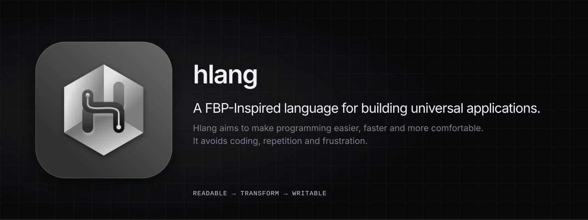
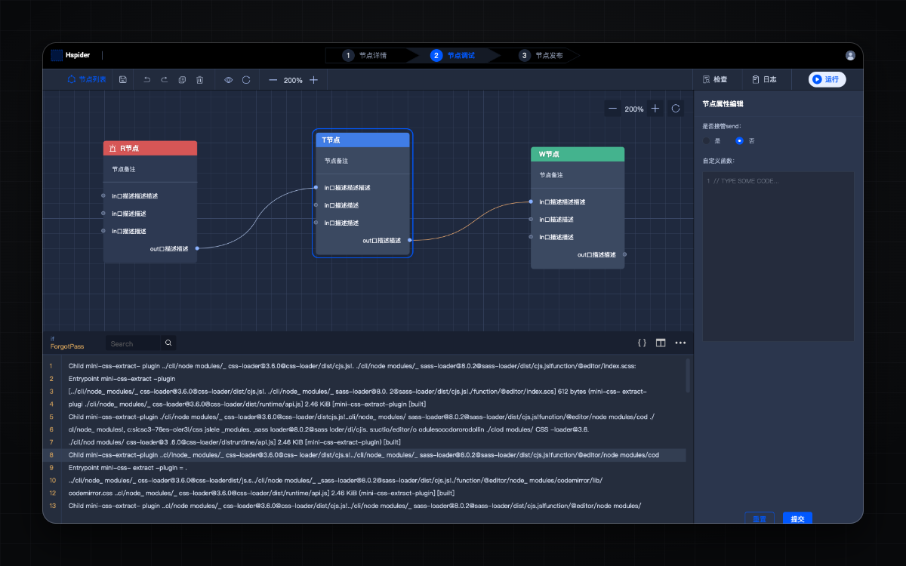
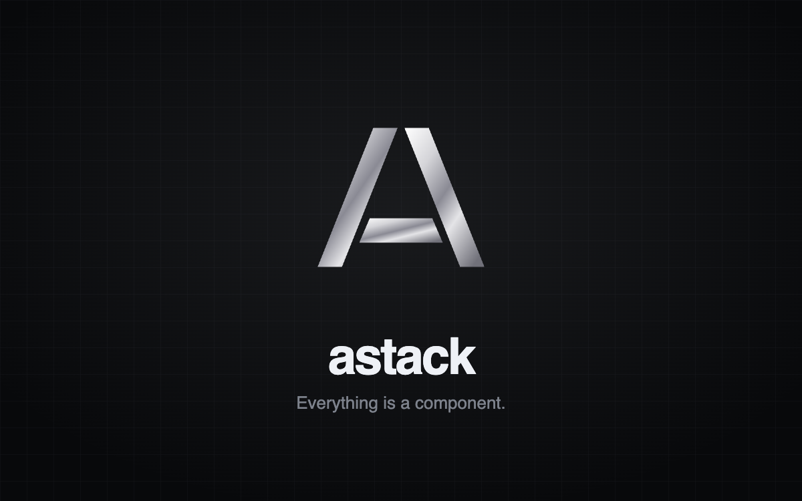
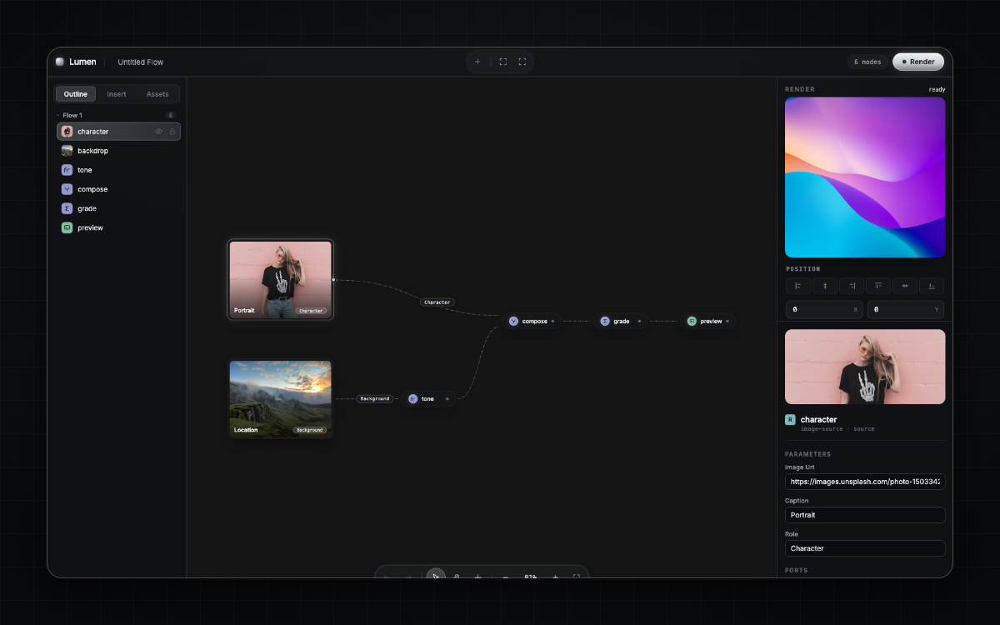
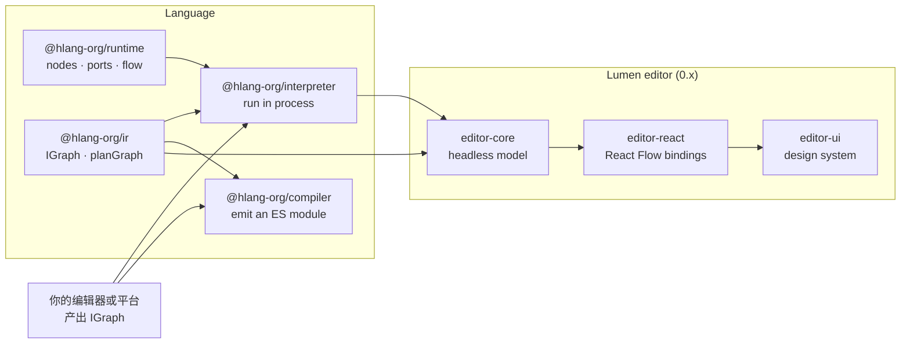

<p align="center">
  
</p>

<p align="center">
  <a href="https://github.com/hlang-tech/hlang/actions/workflows/ci.yml"></a>
  <a href="https://www.npmjs.com/package/@hlang-org/runtime"></a>
  <a href="./LICENSE"></a>
  <a href="https://deepwiki.com/hlang-tech/hlang"></a>
</p>

<p align="center">
  <a href="./README.md">English</a> · <b>简体中文</b>
</p>

hlang 是面向 TypeScript 与 JavaScript 的流式编程（Flow-Based Programming）语言。一个程序就是一张由节点组成的图：节点通过具名端口交换数据，每个端口都是一个 RxJS 流。连接是活的——只要源头还在发出数据，数据就持续在图中流动。

你可以用 runtime 在代码里搭图，把图存成 JSON 程序（`IGraph`），用解释器直接运行，或编译成 ES 模块。hlang 不依赖任何编辑器：可视化工具只需要产出 `IGraph`。已有团队在 hlang 之上构建了自己的编辑器与平台，本仓库则开发了 Lumen——一套面向创作工具的编辑器技术栈。

## 目录

- [核心概念](#核心概念)
- [包](#包)
- [快速开始](#快速开始)
- [基于 hlang 构建](#基于-hlang-构建)
- [架构](#架构)
- [开发](#开发)
- [品牌](#品牌)
- [贡献者](#贡献者)

## 核心概念

| 概念 | 在 hlang 中 |
| --- | --- |
| **节点（Node）** | 计算单元，分三种。 |
| **Readable（R）** | 数据源，只有输出端口。由 `_read($o)` 推送数据。 |
| **Transform（T）** | 既有输入也有输出端口。由 `_transform($i, $o)` 把输入映射为输出。 |
| **Writable（W）** | 数据汇，只有输入端口。由 `_write($i)` 消费数据。 |
| **端口（Port）** | 一个具名的 RxJS `Subject`。`send()` 即 `next()`，`receive()` 即订阅。一个节点可以有任意多个端口。 |
| **错误端口** | Readable 与 Transform 节点都有一个名为 `@node/error` 的输出端口，用于上报错误。 |
| **连接** | `output.connect(input)`，其他方向会被 runtime 拒绝并抛错。允许 Transform 之间成环，因此可以构造反馈回路。 |
| **Flow** | `flow.run(readable)` 从一个 Readable 根节点构建可达的图：先订阅下游，再让源头发出数据。 |
| **IGraph** | 程序的 JSON 形式：`nodeList` 与 `connections`。它是解释器、编译器和编辑器的共同输入。 |

## 包

所有包都发布在 `@hlang-org` 作用域下，并以完全相同的构建同步发布到 `@hlang-tech` 作用域。同一个项目里请只使用其中一个作用域。

| 包 | 版本 | 用途 |
| --- | --- | --- |
| [`@hlang-org/runtime`](./packages/runtime) |  | 基于 RxJS 的节点、端口与 Flow，所有其他包的引擎。 |
| [`@hlang-org/ir`](./packages/ir) |  | `IGraph` 类型与 `planGraph`：解释器和编译器共享的校验与降级步骤。 |
| [`@hlang-org/interpreter`](./packages/interpreter) |  | 在当前进程内运行 `IGraph`，不生成代码。可运行于 Node.js 与浏览器。 |
| [`@hlang-org/compiler`](./packages/compiler) |  | 把 `IGraph` 编译为独立的 ES 模块，行为与解释器一致。 |
| [`@hlang-org/editor-core`](./packages/editor-core) |  | Lumen：无头编辑器模型。命令、撤销重做、校验、诊断、`IGraph` 序列化。 |
| [`@hlang-org/editor-react`](./packages/editor-react) |  | Lumen：把 `editor-core` 绑定到 React Flow 的 React hooks。 |
| [`@hlang-org/editor-ui`](./packages/editor-ui) |  | Lumen：设计系统。节点、连线、面板与编辑器外壳。 |

Lumen 系列包（`editor-*`，0.x 版本）正在活跃开发中，任何 minor 版本都可能调整 API。

## 快速开始

### 用代码搭一张图

```sh
npm install @hlang-org/runtime
```

```js
const { Flow, ReadableNode, TransformNode, WriteableNode, Port } = require('@hlang-org/runtime');

class Greeting extends ReadableNode {
  constructor(opts) {
    super(opts);
    Port.O('out').attach(this);
  }
  _read($o) {
    $o('out').send('hello, hlang');
  }
}

class Uppercase extends TransformNode {
  constructor(opts) {
    super(opts);
    Port.I('in').attach(this);
    Port.O('out').attach(this);
  }
  _transform($i, $o) {
    $i('in').receive((text) => $o('out').send(text.toUpperCase()));
  }
}

class Print extends WriteableNode {
  constructor(opts) {
    super(opts);
    Port.I('in').attach(this);
  }
  _write($i) {
    $i('in').receive((text) => console.log(text));
  }
}

const greeting = new Greeting();
const uppercase = new Uppercase();
const print = new Print();

greeting.O('out').connect(uppercase.I('in'));
uppercase.O('out').connect(print.I('in'));

new Flow().run(greeting); // HELLO, HLANG
```

### 把同一张图当作数据运行

`IGraph` 用 JSON 描述同一个程序。连接中的 `Output` 是上游端口，`Input` 是下游端口。

```js
const { Flow } = require('@hlang-org/runtime');
const { interpret, NodeRegistry } = require('@hlang-org/interpreter');

const registry = new NodeRegistry()
  .register('greeting', Greeting)
  .register('uppercase', Uppercase)
  .register('print', Print);

const graph = {
  nodeList: [
    { nodeId: 'a', code: 'greeting', name: 'Greeting', type: 'R' },
    { nodeId: 'b', code: 'uppercase', name: 'Uppercase', type: 'T' },
    { nodeId: 'c', code: 'print', name: 'Print', type: 'W' },
  ],
  connections: [
    { Output: { nodeId: 'a', portConf: { id: 'out' } }, Input: { nodeId: 'b', portConf: { id: 'in' } } },
    { Output: { nodeId: 'b', portConf: { id: 'out' } }, Input: { nodeId: 'c', portConf: { id: 'in' } } },
  ],
};

const handle = interpret(graph, { registry, createFlow: () => new Flow() });
handle.onError(({ nodeId, error }) => console.error(nodeId, error));
handle.dispose(); // 停止长时间运行的节点
```

### 编译为模块

```js
import { compile } from '@hlang-org/compiler';

const { code, imports } = compile(graph, {
  nodes: {
    greeting: { from: './nodes/greeting.js' },
    uppercase: { from: './nodes/uppercase.js' },
    print: { from: './nodes/print.js' },
  },
});
// `code` 是一个导出 run(options) 的 ES 模块，`imports` 列出它依赖的模块。
```

## 基于 hlang 构建

语言、执行后端与编辑器是彼此独立的层。任何能产出 `IGraph` 的工具，都可以用解释器运行它，或用编译器交付它，因此每个产品都能在同一个引擎上构建自己的界面。

<table>
  <tr>
    <td width="33%" valign="top">
      <a href="https://www.xiaoa.name/events/hlang-chinashop-2020/"></a>
      <p><b>零售门店营运</b><br><sub>盒马 Rex · CHINASHOP 2020</sub></p>
      <p>Rex 门店营运解决方案的逻辑编排引擎，门店逻辑以流程的方式被搭建、演示与调试。</p>
    </td>
    <td width="33%" valign="top">
      <a href="https://github.com/astack-tech/astack"></a>
      <p><b>AStack</b><br><sub>AI 智能体与工作流</sub></p>
      <p>可组合的 TypeScript AI 应用框架，组件、端口与流水线建立在 hlang 的计算模型之上。</p>
    </td>
    <td width="33%" valign="top">
      <a href="#lumen"></a>
      <p><b>Lumen</b><br><sub>编辑器技术栈 · 开发中</sub></p>
      <p>本仓库开发的节点编辑器：无头核心、React 绑定与面向创作工具的设计系统。</p>
    </td>
  </tr>
</table>

### Lumen

Lumen 编辑 `IGraph`，并通过解释器运行它。三层之间的依赖严格单向，每一层都可以替换。

| | `editor-core` | `editor-react` | `editor-ui` |
| --- | --- | --- | --- |
| **层** | 模型 | 绑定 | 设计 |
| **依⁠赖** | `ir`、`interpreter` | `editor-core`、React Flow | `editor-react` |
| **职⁠责** | 带撤销重做的命令、连接校验、编辑期诊断、`IGraph` 序列化。不依赖 React 与 DOM。 | 把核心绑定到 [React Flow](https://reactflow.dev) 的 hooks。输出端口映射为 source，输入端口映射为 target。 | 图片与意图节点、实时连线、大纲、属性面板、节点搜索、右键菜单与快捷键。 |

可以在 `editor-react` 之上换一套设计系统，也可以在 `editor-core` 之上换一个框架绑定。试试 [playground](./examples/editor-react-playground)：

```sh
pnpm install
pnpm dev:playground
```

## 架构



解释器与编译器共享同一个前端：`planGraph` 校验 `IGraph` 并把它降级为执行计划。解释器在当前进程内执行这份计划，编译器把同一份计划输出为 ES 模块。有一个测试会让同一张图分别经过两个后端运行，并比对结果。

## 开发

本仓库是一个 [pnpm](https://pnpm.io) workspace，任务由 [Turborepo](https://turborepo.com) 编排，发版使用 [Changesets](https://github.com/changesets/changesets)。请使用 [`.nvmrc`](./.nvmrc) 中的 Node.js 版本。

```sh
pnpm install        # 安装并链接整个 workspace
pnpm build          # 构建所有包
pnpm check          # 构建、类型检查、lint 与测试，即 CI 门禁
pnpm lint:pkg       # 校验可发布的包（publint + attw）
```

`main` 存放已发布的代码，`develop` 存放下一个版本。请从 `develop` 拉出 `feature/*` 分支开始工作。工作流、质量标准与发版流程见 [CONTRIBUTING.md](./.github/CONTRIBUTING.md)，面向人与编码智能体的工程规则见 [AGENTS.md](./AGENTS.md)。

## 品牌

hlang 的标志是一个带着一条连接的节点：立方体、输出端点、构成字母 H 的走线，以及输入端点。构造方式、配色与文件见[品牌指南](./media/brand/README.md)。

## 贡献者

<table>
  <tbody>
    <tr>
      <td align="center" valign="top" width="14.28%"><a href="https://github.com/archersado"><br /><sub><b>archersado</b></sub></a></td>
      <td align="center" valign="top" width="14.28%"><a href="https://xiaoa.name"><br /><sub><b>Archer</b></sub></a></td>
    </tr>
  </tbody>
</table>

## 许可证

[MIT](./LICENSE) © hlang-tech
