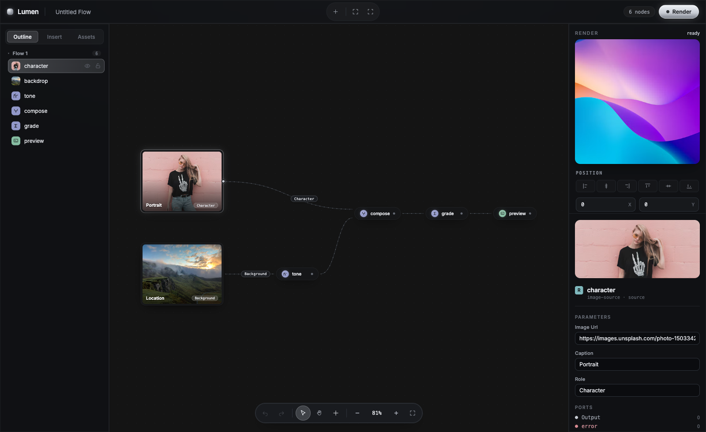

# Lumen playground

A Vite app that assembles the Lumen editor packages (`editor-core`, `editor-react`, `editor-ui`) on top of the interpreter and runtime. It is the place to try and verify editor features. It is not a product.



## Run

From the repository root:

```sh
pnpm install
pnpm dev:playground   # http://localhost:5173
```

Workspace packages are linked by pnpm. Turborepo builds them before the dev server starts.

## What it shows

- A starter flow: two image sources (a portrait and a location) feed `tone`, `compose`, `grade`, and a `preview` sink. The flow is a plain `IGraph` in [`src/templates/showcase-flow.ts`](./src/templates/showcase-flow.ts).
- The left rail: the outline tree, the node palette (Insert), and assets.
- The right rail: the render preview, the position panel, and the inspector, which renders a form from each node's parameters.
- Editing: connect ports (only output to input), double-click the canvas or drop a connection on empty space to search for a node, drop a node onto an edge to insert it, copy and paste, rename, hide, lock, and undo or redo every step. Press `?` for all shortcuts.
- **Render** runs the graph with the interpreter in the browser. Edges and nodes light up while data flows; press **Stop** to dispose the run.

The node kit is in [`src/nodes/kit`](./src/nodes/kit): sources, transforms, and sinks written against `@hlang-org/runtime`.

Running the interpreter in the browser verifies the full stack. In Prism, the product built on Lumen, execution runs on a server.
