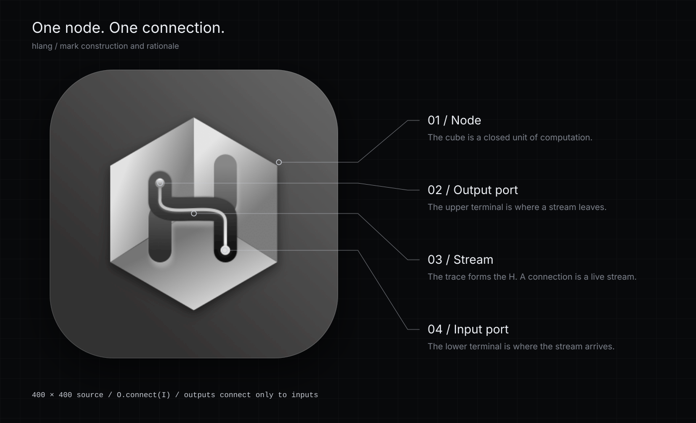

# hlang brand

The hlang mark shows the smallest complete hlang program: one node with one connection.



## Concept

The mark is an isometric cube. A trace starts at a terminal on the upper left, follows the crossbar of the letter H, and ends at a terminal on the lower right.

- **Node:** the cube is a closed unit of computation, like a Readable, Transform, or Writable node.
- **Output port:** the upper terminal is where a stream leaves.
- **Stream:** the trace forms the H. In hlang a connection is a live RxJS stream, not a static wire.
- **Input port:** the lower terminal is where the stream arrives. Outputs connect only to inputs (`O.connect(I)`).

This is a visual interpretation of the language model. It is not a diagram of a specific runtime graph.

## The mark is a fixed original

[`media/logo.png`](../logo.png) (400 × 400) is the hand-designed original. Do not redraw, recolor, or re-crop it. Every brand file embeds its exact bytes, and `check.cjs` verifies this.

In compositions the mark is presented as an app icon: clipped to a rounded square with a corner radius of 22% of its size, a hairline silver edge at 22% opacity, and a soft drop shadow. Keep at least 12% of the icon size as clear space around it. Do not show the mark smaller than 24 px.

## Color

The palette is shared with the Lumen editor tokens in [`packages/editor-ui/src/tokens/tokens.css`](../../packages/editor-ui/src/tokens/tokens.css).

| Role | Token | Value |
| --- | --- | --- |
| Void (background) | `--hl-void` | `#08090b` |
| Surface | `--hl-surface` | `#0f1114` |
| Silver (primary accent) | `--hl-silver` | `#c8ccd4` |
| Silver, bright edge | `--hl-silver-hi` | `#eef1f6` |
| Silver, dim / secondary text | `--hl-silver-lo` | `#7d828c` |
| Spark (live data only) | `--hl-spark` | `#f7f9fc` |

Black and silver carry the identity. Moving data is shown by light, not by a hue: the spark is brighter than any resting silver, and is used only for data that is moving.

## Type

Interface and headlines use Inter, with the system sans-serif as fallback. Code, values, and technical labels use a monospace face (SF Mono, Menlo, Consolas).

## Files

| File | Use |
| --- | --- |
| [`../logo.png`](../logo.png) | The original mark, 400 × 400 |
| [`readme-banner.svg`](./readme-banner.svg) | Repository banner, 1280 × 480 |
| [`social-card.svg`](./social-card.svg) / [`social-card.png`](./social-card.png) | Social preview, 1280 × 640 (GitHub repository social preview) |
| [`avatar.svg`](./avatar.svg) / [`avatar.png`](./avatar.png) | Organization avatar, 512 × 512 |
| [`logo-construction.svg`](./logo-construction.svg) | Construction and rationale sheet, 1400 × 850 |
| [`../lumen-editor.png`](../lumen-editor.png) | The Lumen editor running a flow of generic stream nodes |
| [`../prism.png`](../prism.png) | Case screenshot: Prism, a tool for image and video creators built on Lumen |
| [`../ui.png`](../ui.png) | Case screenshot: a node development tool built on hlang for the CHINASHOP 2020 retail solution |

## Writing

Describe what the code does. Name the package, function, or port when it helps the reader. Prefer short sentences and active verbs. Mark unreleased or experimental work as such. Do not claim performance or production use without evidence.

## Regenerate and verify

From the repository root:

```sh
node media/brand/generate.cjs   # writes the SVG files
node media/brand/check.cjs      # verifies every SVG embeds the unmodified mark
```

The PNG exports are the SVGs rendered at their native size in a browser.
