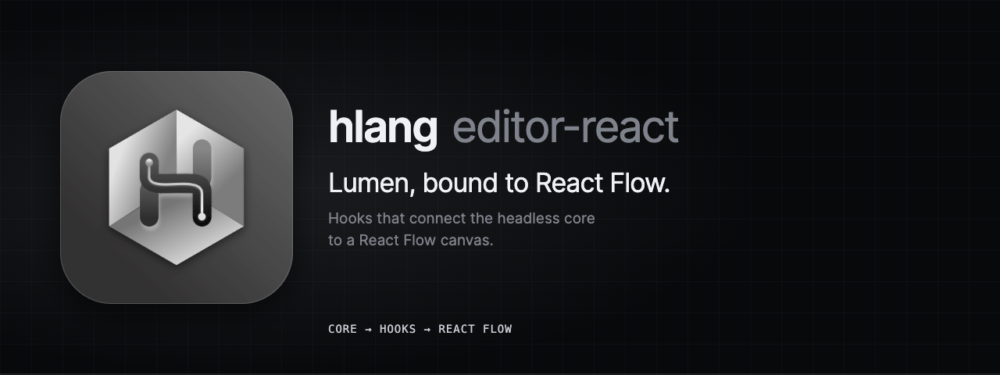

<p align="center">
  
</p>

# @hlang-org/editor-react

React bindings for Lumen, the hlang visual editor. The hooks connect a headless [`@hlang-org/editor-core`](https://www.npmjs.com/package/@hlang-org/editor-core) to [React Flow](https://reactflow.dev). This package adds no styling; the design system is [`@hlang-org/editor-ui`](https://www.npmjs.com/package/@hlang-org/editor-ui).

[](https://www.npmjs.com/package/@hlang-org/editor-react)
[](https://github.com/hlang-tech/hlang/blob/main/LICENSE)

> **Status:** 0.x, in active development. The API can change in any minor release.

## Install

```sh
npm install @hlang-org/editor-react @hlang-org/editor-core @xyflow/react react react-dom
```

The same build is published as `@hlang-tech/editor-react`. Peer dependencies: `react` and `react-dom` 18 or later, `@xyflow/react` 12.

## Usage

```tsx
import { ReactFlow, ReactFlowProvider } from '@xyflow/react';
import '@xyflow/react/dist/style.css';
import { createEditorCore } from '@hlang-org/editor-core';
import { useHlangFlow } from '@hlang-org/editor-react';

const core = createEditorCore();
// register node descriptors and add nodes...

function Canvas() {
  const flow = useHlangFlow(core);
  return <ReactFlow {...flow} fitView />;
}

export function Editor() {
  return (
    <ReactFlowProvider>
      <Canvas />
    </ReactFlowProvider>
  );
}
```

`useHlangFlow` returns `nodes`, `edges`, `onNodesChange`, `onEdgesChange`, `onConnect`, and `isValidConnection`. Spread them into `<ReactFlow>`.

## How the binding works

- **Direction.** An output (O) port is a React Flow `source` / `sourceHandle`; an input (I) port is a `target` / `targetHandle`. `isValidConnection` asks the core's validator, so invalid links are refused while dragging.
- **Commands.** Connecting, deleting, moving, and renaming are executed as core commands, so every canvas edit can be undone.
- **Dragging.** Positions update locally while a node is dragged, and one move command is committed when the drag ends. Undo and redo move nodes on the canvas.
- **Subscriptions.** Hooks read the core through `useSyncExternalStore` and re-render only when the relevant core events fire.

## Hooks

| Hook | Returns |
| --- | --- |
| `useHlangFlow(core)` | Props for `<ReactFlow>`, as above. |
| `useGraphSync(core)` | The current nodes and edges of the model. |
| `useConnect(core)`, `useIsValidConnection(core)` | The connect handler and the validation callback. |
| `useNodeChanges`, `useEdgeChanges` | React Flow change handlers that commit to the core. |
| `useHistory(core)` | `canUndo`, `canRedo`, `undo`, `redo`. |
| `useSelection(core)` | Selected node and edge ids, with selection setters. |
| `useViewState(core)` | Hidden and locked node flags, with setters and toggles. |
| `useClipboard(core)` | Copy, cut, paste, and duplicate of the selection, including the system clipboard. |
| `useRename(core)` | Rename a node through a command. |
| `useDiagnostics(core)` | The core's edit-time diagnostics, also grouped by node. |
| `useReconnect(core)` | Move an edge endpoint to another port, and find the edge under a dragged node for drop-to-insert. |

`EditorProvider` and `useEditor` share one core through React context. The mapping helpers `toRFNode`, `toRFEdge`, `endpointsFromConnection`, and `findPort` are exported for custom bindings.

Source and documentation: [github.com/hlang-tech/hlang](https://github.com/hlang-tech/hlang).

## License

MIT
