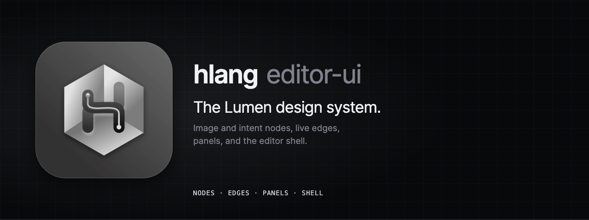
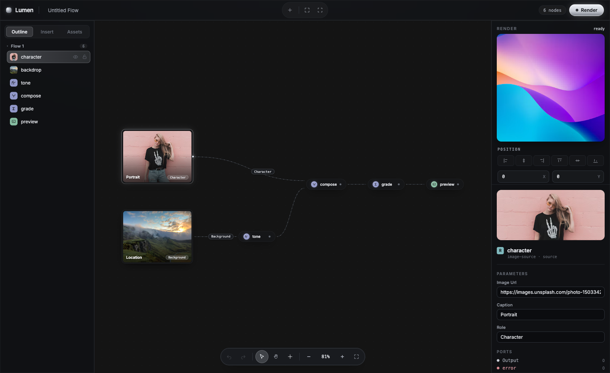

<p align="center">
  
</p>

# @hlang-org/editor-ui

The Lumen design system for hlang: React components for a node editor built on React Flow and [`@hlang-org/editor-react`](https://www.npmjs.com/package/@hlang-org/editor-react). Black and silver surfaces, image and intent nodes, live edges, and the panels around the canvas.

[](https://www.npmjs.com/package/@hlang-org/editor-ui)
[](https://github.com/hlang-tech/hlang/blob/main/LICENSE)

> **Status:** 0.x, in active development. The API can change in any minor release.

<p align="center">
  
</p>

## Install

```sh
npm install @hlang-org/editor-ui @hlang-org/editor-react @hlang-org/editor-core @xyflow/react react react-dom
```

The same build is published as `@hlang-tech/editor-ui`. Import the stylesheet once:

```ts
import '@xyflow/react/dist/style.css';
import '@hlang-org/editor-ui/styles.css';
```

## Usage

```tsx
import { ReactFlow, ReactFlowProvider } from '@xyflow/react';
import { useHlangFlow } from '@hlang-org/editor-react';
import { createHlangFlowTypes } from '@hlang-org/editor-ui';

const { nodeTypes, edgeTypes } = createHlangFlowTypes();

function Canvas({ core }) {
  const flow = useHlangFlow(core);
  return <ReactFlow {...flow} nodeTypes={nodeTypes} edgeTypes={edgeTypes} colorMode="dark" fitView />;
}
```

`createHlangFlowTypes` registers the node and edge components for the three node kinds. A node renders as a framed image when its `imageUrl` parameter is set, and as a pill otherwise. An edge shows the source node's `role` parameter as a label. The runtime contract does not change: every node is still a Readable, Transform, or Writable node with ports.

See the [playground](https://github.com/hlang-tech/hlang/tree/main/examples/editor-react-playground) for a complete editor.

## Components

| Area | Exports |
| --- | --- |
| Nodes and edges | `HlangNode`, `AssetNodeChrome`, `PillNodeChrome`, `NodeChrome`, `PortRow`, `SignalBar`, `NodeBodySlot`, `FlowEdge`, `createHlangFlowTypes` |
| Shell and toolbar | `EditorShell`, `Toolbar`, `UndoRedo`, `RunButton`, `ToolbarStat`, `ToolbarGhostButton`, `ToolCluster` |
| Canvas | `CanvasChrome`, `CanvasDock`, `EmptyState` |
| Panels | `OutlineTree`, `RailTabs`, `AssetGrid`, `InspectorPanel`, `ParamForm`, `PositionPanel`, `PreviewPanel`, `DiagnosticBadge` |
| Creating nodes | `NodeSearch`, `useNodeSearch`, `useNodeSearchTriggers` (double-click the canvas, or drop a connection on empty space) |
| Interaction | `useEditorHotkeys`, `NodeContextMenu`, `useNodeContextMenu`, `NodeInteractionProvider`, `Cheatsheet`, `ToastProvider` |
| Live execution | `LiveSignalProvider`, `LiveSignalStore`, `useLiveSignals`, `useNodeLiveState`, `useEdgeFlowing` |
| Theme | `TOKEN_NAMES`, `tokenVar`, `createTheme`, `EditorUIThemeProvider` |

### Keyboard shortcuts

`useEditorHotkeys(core)` binds undo (`⌘Z`), redo (`⇧⌘Z` or `⌘Y`), copy, cut, paste, duplicate (`⌘D`), select all (`⌘A`), and delete (`Delete` or `Backspace`). `Ctrl` replaces `⌘` on Windows and Linux. Shortcuts are ignored while a text field has focus.

### Live execution

`useLiveSignals(core, handle)` feeds a run's activity and errors into a `LiveSignalStore`. Nodes and edges subscribe by id, so only the elements whose state changes re-render.

### Theming

All colors, fonts, and radii are CSS custom properties (`--hl-*`). Override them with `createTheme({ 'hl-silver': '#d8dce4' })` passed as a `style`, or with `EditorUIThemeProvider`.

Source and documentation: [github.com/hlang-tech/hlang](https://github.com/hlang-tech/hlang).

## License

MIT
