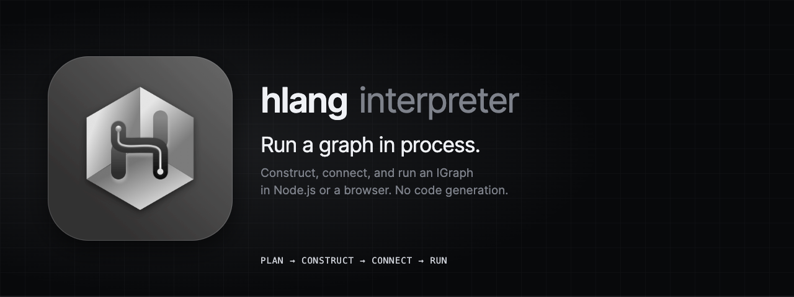

<p align="center">
  
</p>

# @hlang-org/interpreter

Runs an hlang program (`IGraph`) in the current process. It builds the nodes, connects their ports, and runs the flow, with no code generation and no file access. It works in Node.js and in browsers.

[](https://www.npmjs.com/package/@hlang-org/interpreter)
[](https://github.com/hlang-tech/hlang/blob/main/LICENSE)

## Install

```sh
npm install @hlang-org/interpreter @hlang-org/runtime rxjs
```

The same build is published as `@hlang-tech/interpreter`. ESM and CommonJS builds with type declarations.

## Usage

```ts
import { Flow } from '@hlang-org/runtime';
import { interpret, NodeRegistry } from '@hlang-org/interpreter';

const registry = new NodeRegistry()
  .register('numbers', Numbers) // classes that extend the runtime's node classes
  .register('double', Double)
  .register('log', Log);

const handle = interpret(graph, { registry, createFlow: (options) => new Flow(options) }, { env: 'prod' });

handle.onError(({ nodeId, error }) => console.error(nodeId, error));
handle.onActivity(({ nodeId, portId }) => highlight(nodeId, portId));

// Later: stop long-running nodes and release subscriptions.
handle.dispose();
```

## What `interpret` does

1. Validates the graph with `planGraph` from [`@hlang-org/ir`](https://www.npmjs.com/package/@hlang-org/ir). Invalid graphs throw a `GraphError`.
2. Constructs every node with `new NodeClass({ nodeId, flowId, env, middleware, config, signal })`. `config` is the node's `bizData`.
3. Subscribes the `@node/error` port of every Readable and Transform node.
4. Connects each connection as `source.O(port).connect(target.I(port))`.
5. Runs every Readable root with a new `Flow`, created by `deps.createFlow` with the options described below.

`@hlang-org/compiler` emits the same steps as an ES module.

## API

### `interpret(graph, deps, options?)`

| Argument | Description |
| --- | --- |
| `deps.registry` | A `NodeRegistry` that maps each node `code` to a node class. |
| `deps.createFlow` | Returns a new runtime `Flow` from the options it is given: `(options) => new Flow(options)`. The options carry `onError`, so a Writable node's failure reaches `handle.onError`, and, when tracing, the flow's observer. |
| `options.flowId` | Flow id passed to every node. Generated when omitted. |
| `options.env` | Environment label passed to every node. Default `'prod'`. |
| `options.middleware` | Object passed to every node, for services such as a logger. |
| `options.trace` | Report every delivery through `onDelivery`, with its timing. Default `false`: an untraced run reads no clock. |

It throws if a node `code` is not registered.

### Execution handle

| Member | Description |
| --- | --- |
| `flowId` | The flow id of this run. |
| `roots` | The Readable root nodes. |
| `getNode(nodeId)` | The constructed node, or `undefined`. |
| `onError(listener)` | Errors sent on any `@node/error` port, and failures of a Writable node's handlers (a Writable has no error port). Errors sent while the flow starts are buffered, so a listener added after `interpret` returns still receives them. Returns a disposable. |
| `onActivity(listener)` | Fires when data passes a connection, for both the source port and the target node. Returns a disposable. |
| `onDelivery(listener)` | With `trace: true`, fires for every message delivered on a connection: `{ sourceNodeId, sourcePortId, targetNodeId, targetPortId, message, duration }`, where `duration` is how long the receiving node's handlers took, in milliseconds. The most recent 500 deliveries are replayed to a listener added later. Returns a disposable. |
| `dispose()` | Stops the run: emits the stop signal, calls `onStop` callbacks, and unsubscribes the interpreter's observers. |

### Stop signal

Every node receives `signal` in its constructor options. Bind long-running work to it:

```js
interval(1000).pipe(takeUntil(this.opts.signal.observable)).subscribe(tick);
this.opts.signal.onStop(() => socket.close());
```

### `NodeRegistry`

`register(code, NodeClass)` (chainable; the last registration wins), `get(code)`, `has(code)`, `codes()`.

The package also re-exports `planGraph`, `GraphError`, and the `IGraph` types from `@hlang-org/ir`.

Source and documentation: [github.com/hlang-tech/hlang](https://github.com/hlang-tech/hlang).

## License

MIT
