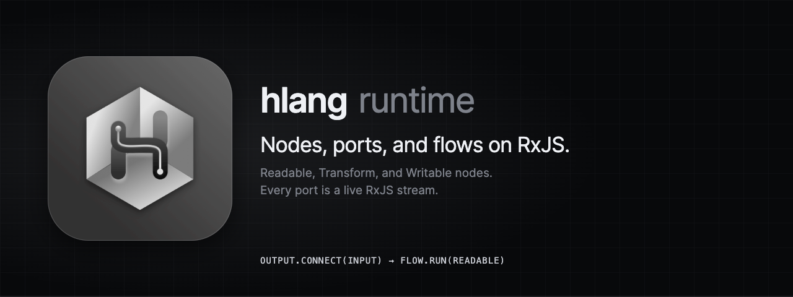

<p align="center">
  
</p>

# @hlang-org/runtime

The hlang runtime: flow-based programming on RxJS streams. Build programs from Readable, Transform, and Writable nodes connected through named ports.

[](https://www.npmjs.com/package/@hlang-org/runtime)
[](https://github.com/hlang-tech/hlang/blob/main/LICENSE)

## Install

```sh
npm install @hlang-org/runtime
```

The same build is published as `@hlang-tech/runtime`. It ships an ES module and a CommonJS build with type declarations; `import` and `require` both work.

## Example

```js
const { Flow, ReadableNode, TransformNode, WriteableNode, Port } = require('@hlang-org/runtime');

class Numbers extends ReadableNode {
  constructor(opts) {
    super(opts);
    Port.O('out').attach(this);
  }
  _read($o) {
    [1, 2, 3].forEach((n) => $o('out').send(n));
  }
}

class Double extends TransformNode {
  constructor(opts) {
    super(opts);
    Port.I('in').attach(this);
    Port.O('out').attach(this);
  }
  _transform($i, $o) {
    $i('in').receive((n) => $o('out').send(n * 2));
  }
}

class Log extends WriteableNode {
  constructor(opts) {
    super(opts);
    Port.I('in').attach(this);
  }
  _write($i) {
    $i('in').receive((n) => console.log(n));
  }
}

const numbers = new Numbers();
const double = new Double();
const log = new Log();

numbers.O('out').connect(double.I('in'));
double.O('out').connect(log.I('in'));

new Flow().run(numbers); // 2, 4, 6
```

## Nodes

| Class | Kind | Ports | Implement |
| --- | --- | --- | --- |
| `ReadableNode` | R, a source | outputs, plus `@node/error` | `_read($o)` |
| `TransformNode` | T | inputs and outputs, plus `@node/error` | `_transform($i, $o)` |
| `WriteableNode` | W, a sink | inputs only, no error port | `_write($i)` |

Create ports in the constructor with `Port.I(name).attach(this)` and `Port.O(name).attach(this)`. A node can have any number of named ports. The constructor argument is stored as `this.opts`. The interpreter and the compiler pass `{ nodeId, flowId, env, middleware, config, signal }`, and node parameters are in `this.opts.config.params`.

The runtime calls `_read`, `_transform`, or `_write` once per flow. `$i(name)` and `$o(name)` return the node's input and output ports. Inside a node, `this.I(name)`, `this.O(name)`, and `this.E()` (the error port) return the same ports.

Readable and Transform nodes have `throw(error)`, which sends `error` on `@node/error`.

## Ports

A port wraps an RxJS `Subject`.

| Method | Effect |
| --- | --- |
| `send(message)` | Emits `message` (`next`). |
| `receive(listener)` | Subscribes `listener`. Returns the RxJS `Subscription`. |
| `pipe(...operators)` | Applies RxJS operators to what the port emits. Returns `{ receive }`. |
| `connect(input)` | Connects this output port to an input port. Throws unless the direction is output to input. |

Ports are multicast: one output can feed several inputs, and an input can receive from several outputs.

## Flows

`new Flow().run(readable)` collects the nodes reachable from the Readable root through its connections. It starts the Writable nodes first, then the Transform nodes, then the Readable root, so every subscriber exists before data is sent. Run each Readable root of a graph. `run` throws if its argument is not a Readable node.

Transform nodes can form cycles, so a graph can contain feedback loops. Bound a feedback loop, for example with `take` or a counter, so it ends.

## Related packages

- [`@hlang-org/interpreter`](https://www.npmjs.com/package/@hlang-org/interpreter) runs a JSON graph (`IGraph`) with these nodes.
- [`@hlang-org/compiler`](https://www.npmjs.com/package/@hlang-org/compiler) compiles a JSON graph to an ES module.

Source, issues, and documentation: [github.com/hlang-tech/hlang](https://github.com/hlang-tech/hlang).

## License

MIT
